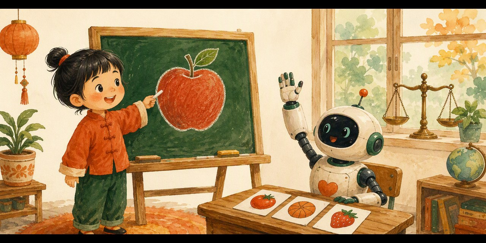

# 🍎 Apple or Not · 教机器认苹果

一个给孩子玩的**感知机（Perceptron）启蒙网页游戏**——1958 年，AI 就是从这台「打分机器」开始学会认东西的。

**👉 点这里直接玩：&lt;https://pulj26pulj26.github.io/apple-or-not/&gt;**

## 怎么玩

你是一位「AI 教练」，要教一台小机器认出苹果：

1. **抽一张卡片**——机器先看图猜「是不是苹果」（它一开始全靠瞎猜 😅）
2. **你来判对错**——判对了奖励它，判错了告诉它
3. **看它自己学习**——答错一次，它就调整一次「线索分数」（权重），越来越准！
4. **三关挑战**——认苹果 → 认橙子 → 最终 Boss「神秘果」🫐

&gt; ⚠️ 第三关藏着一个彩蛋：这一关**永远也教不会**——因为 1969 年科学家真的发现了感知机的这个天花板（异或问题），它直接引出了后来的神经网络。孩子发现「学不会」的那一刻，就是最重要的一课。

通关可集齐三枚教练徽章，领取「金牌教练证书」🏅

## 特点

- 📱 手机、电脑都能玩，双击打开或点开链接即可
- 🔌 单个 HTML 文件，零安装、无需联网
- 🧠 游戏里的学习规则就是**真实的感知机算法**（答错调权重）
- 👧 适合 7-14 岁孩子，配套【和孩子一起学AI】社群「AI十哲」第二课

## 本地运行

下载 `index.html`，双击用浏览器打开即可。

## 系列游戏

| 课程 | 游戏 | 仓库 |
|---|---|---|
| 第一课 · 图灵测试 | 《真人还是 AI》 | [human-or-ai](https://github.com/pulj26pulj26/human-or-ai) |
| 第二课 · 感知机 | 《教机器认苹果》 | **apple-or-not**（本仓库） |

---

*和孩子一起学AI · AI十哲系列* —— 把经典 AI 论文变成孩子能玩的游戏。

---

# 🍎 Apple or Not

A kid-friendly web game about the **Perceptron** (1958) — the first machine that learned to "see".

**👉 Play now: &lt;https://pulj26pulj26.github.io/apple-or-not/&gt;**

## How to play

You are an AI coach teaching a little robot to recognize apples:

1. **Draw a card** — the robot guesses "apple or not" (it's just guessing at first 😅)
2. **Judge its answer** — right or wrong, your call
3. **Watch it learn** — every mistake tunes its clue-scores (weights) for real
4. **Three levels** — apples → oranges → the final boss "Mystery Berry" 🫐

&gt; ⚠️ Level 3 hides a surprise: it can **never** be solved — the same ceiling scientists discovered in 1969 (the XOR problem), which led straight to neural networks.

## Features

- 📱 Works on phones and desktops — just open the link
- 🔌 One single HTML file, no install, works offline
- 🧠 The learning rule inside is the **real perceptron algorithm**
- 👧 Designed for kids aged 7-14

## Run locally

Download `index.html` and double-click it.

*Part of the "AI Classics for Kids" series — turning landmark AI papers into games children can play.*
